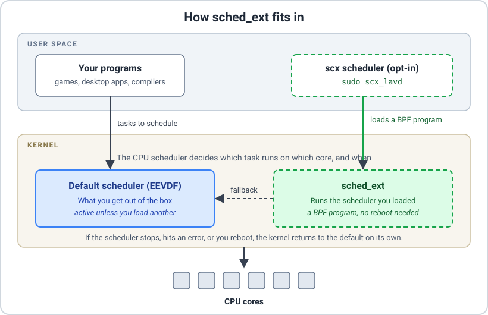

# Opt-in CPU Schedulers: What We're Adding, and What to Expect

The CPU scheduler is the part of the kernel that decides which program runs on which core, and when. Linux has a built-in answer to that question: a scheduler called EEVDF (Earliest Eligible Virtual Deadline First), which replaced the older CFS in kernel 6.6. For most people it's a good one. But different workloads want different trade-offs, and until recently, trying a different scheduler meant patching and rebuilding your kernel.

With the next kernel update, that changes. Both our Stable and LTS kernels will ship with **sched_ext** enabled.

## What is sched_ext?

sched_ext is a Linux kernel feature (available since 6.12) that lets a CPU scheduler be written as a small BPF program and loaded from user space while the system is running. No reboot, no kernel rebuild.

It has a safety net built in: if the kernel detects a scheduling problem, it reverts to the default scheduler and carries on.[1](#fn:1) And nothing changes until you load a scheduler yourself. Out of the box, MocaccinoOS behaves exactly as before.

## What we changed

The kernel configuration for sched_ext needs a few supporting options (BTF type information, function tracing hooks and a few BPF settings). That has a small cost for everyone: the kernel carries a few megabytes of extra type information, and the tracing hooks should be negligible when tracing isn't in use. We think that's a fair price for being able to offer this, but we'd rather say it than hide it.



## How to try it

Update to the new kernel and reboot, then install the schedulers:

`$ sudo luet install apps/scx`

Start one from a terminal, for example:

`$ sudo scx_lavd`

You can check that it's active from another terminal:

```
$ cat /sys/kernel/sched_ext/state
enabled
$ cat /sys/kernel/sched_ext/root/ops
```

Press Ctrl+C to stop it and the kernel goes back to the default scheduler. A scheduler started this way also stops at reboot. We've tested **scx_lavd** (aimed at gaming and interactive use) and **scx_bpfland** (aimed at low response times). The scx project ships others, but we haven't tried them.

## What kind of gain should you actually expect?

We want to be direct here, because scheduler claims are easy to inflate.

The scx_lavd developers report that it consistently reaches higher frame rates than the default scheduler in games, with fewer stutters and slightly lower power use.[1](#fn:1) That's their measurement, on their workloads. We haven't run our own benchmarks yet.

Independent results tell a more mixed story. In one third-party benchmark from June 2026 covering throughput-style workloads such as compiling and stress tests, the default scheduler (EEVDF) finished essentially tied for fastest, while scx_lavd took roughly 8% longer in total.[2](#fn:2) That makes sense: a scheduler tuned for low latency may give up some raw throughput. And in GPU-bound games the CPU scheduler has little room to matter at all.

So expect something workload-dependent: possibly smoother frame times under load, possibly nothing you can notice, and in some cases a slowdown. If you try it and it doesn't help, that's a legitimate outcome, not a bug.

## Then why add it at all?

Because the cost of opting in is one command, and the cost of not opting in is zero. Anyone who wants to experiment with schedulers, for gaming, for desktop responsiveness or just out of curiosity, can do it on a stock kernel now, without compiling anything. And if a scheduler misbehaves, the kernel falls back by itself.

* * *

## Further technical reading

- [Linux kernel documentation: Extensible Scheduler Class](https://docs.kernel.org/6.12/scheduler/sched-ext.html) — how sched_ext works and when it falls back
- [LWN: sched_ext and the schedulers built on it](https://lwn.net/Articles/991205/) — talks on scx_lavd, scx_bpfland and others
- [sched-ext/scx on GitHub](https://github.com/sched-ext/scx) — the scheduler collection we package

* * *

1. [LWN.net: sched_ext](https://lwn.net/Articles/991205/) [↩︎](#fn:1)
2. [PANDEMONIUM scheduler benchmark (June 2026)](https://reddit.sentinel-team.org/posts/1u5uf16/snapshots/2026-06-19T21%3A03%3A49.564114Z) [↩︎](#fn:2)